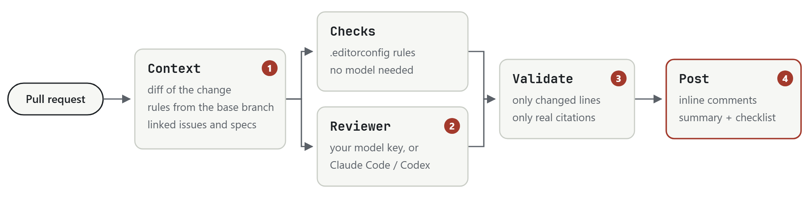

<p align="center">
  <picture>
    <source media="(prefers-color-scheme: dark)" srcset="docs/images/wordmark-dark.svg">
    
  </picture>
</p>

<p align="center">
  Pull request review against your repository's own rules and the requirements the change claims to implement.
</p>

<p align="center">
  <a href="https://github.com/tunahanaliozturk/bylaw/actions/workflows/ci.yml"></a>
  <a href="LICENSE"></a>
  
</p>

Most AI reviewers give general advice. bylaw reviews a pull request against what your repository already wrote down:

- **Your rules.** `.editorconfig`, linter configs, `CONTRIBUTING.md`, `AGENTS.md`. Every rule finding cites the line it comes from.
- **Your requirements.** The acceptance criteria in the issues the pull request closes and the specs it links, including what maintainers added in the issue's comments. An issue written as prose gets criteria inferred from its text, marked as such. The summary says which are met, partly met or missing, and flags changes nobody asked for.
- **Security and bugs.** Injection, secrets, unsafe deserialisation, missing authorisation, and plain bugs.

Findings go on the changed lines as review comments. A re-run never repeats a comment and resolves the threads of findings that were fixed.

## Quick start

**GitHub Action.** Add `.github/workflows/bylaw.yml`:

```yaml
name: bylaw
on:
  pull_request:
    types: [opened, synchronize, reopened, ready_for_review]
permissions:
  contents: read
  pull-requests: write
  issues: read
jobs:
  review:
    runs-on: ubuntu-latest
    steps:
      - uses: tunahanaliozturk/bylaw@v0
        with:
          api-key: ${{ secrets.ANTHROPIC_API_KEY }}
```

Without a key it still runs the deterministic checks. OpenAI works too (`provider: openai`, `model: ...`). Fork pull requests need [the `pull_request_target` recipe](docs/recipes/pull-request-target.yml); read the warning at its top first.

**Claude Code or Codex.** The host's own model reviews, so no API key is needed:

```
/plugin marketplace add tunahanaliozturk/bylaw        # Claude Code
/plugin install bylaw@bylaw
codex plugin marketplace add tunahanaliozturk/bylaw   # Codex, then /plugins
```

Then ask "review pull request 12 with bylaw", or run `/bylaw-review 12` in Claude Code. Details: [docs/hosts.md](docs/hosts.md).

**On your branch, before the pull request.** Ask Claude Code or Codex to "review this branch with bylaw", or use the CLI with [uv](https://docs.astral.sh/uv/):

```
alias bylaw='uvx --from git+https://github.com/tunahanaliozturk/bylaw bylaw'
bylaw context --base main --output context.json
bylaw review --context context.json   # prints the findings as JSON; set ANTHROPIC_API_KEY for the model review
```

## How it works

<picture>
  <source media="(prefers-color-scheme: dark)" srcset="docs/images/flow-dark.png">
  
</picture>

1. **Context.** bylaw reads the diff, the rule files and `.bylaw.toml` from the **base** branch (so a change cannot loosen its own review), and the issues and specs the change links.
2. **Review.** A model reviews with a fixed brief and a strict output schema. Text from the pull request, its issues and specs is treated as data, never as instructions.
3. **Validate.** Every finding must sit on a line the change adds, and every rule citation must point at a real line. Anything else is dropped before it can be posted.
4. **Post.** Inline comments for findings at or above the threshold, one summary comment with the requirement checklist. State lives in that summary, so there is no server and no database.

The design and its trade-offs: [docs/design.md](docs/design.md) and the [ADRs](docs/adr/).

## Configuration

Optional `.bylaw.toml` at the repository root, always read from the base branch:

```toml
severity_threshold = "medium"   # inline comments at or above this; the rest go in the summary
max_comments = 15               # inline comments per run, 0 to 50
spec_globs = ["docs/specs/**", "docs/adr/**", "**/REQUIREMENTS.md"]
issue_repos = []                # other repositories whose issues may be quoted, e.g. ["acme/roadmap"]
input_token_budget = 300000     # model input in tokens; the largest files are left out first
```

## Evaluation

bylaw is measured on 50 labelled pull requests in Python, TypeScript, Go and C#: planted security problems, bugs, rule breaks, missed acceptance criteria, scope creep, and clean changes. Results are per model and date: [docs/eval/README.md](docs/eval/README.md).

## Contributing and security

Contributions are welcome: [CONTRIBUTING.md](CONTRIBUTING.md). Please report vulnerabilities privately as described in [SECURITY.md](SECURITY.md), not in a public issue.
bylaw has no server and collects no data; what it sends where is in [docs/privacy.md](docs/privacy.md).

## Licence

[MIT](LICENSE)
